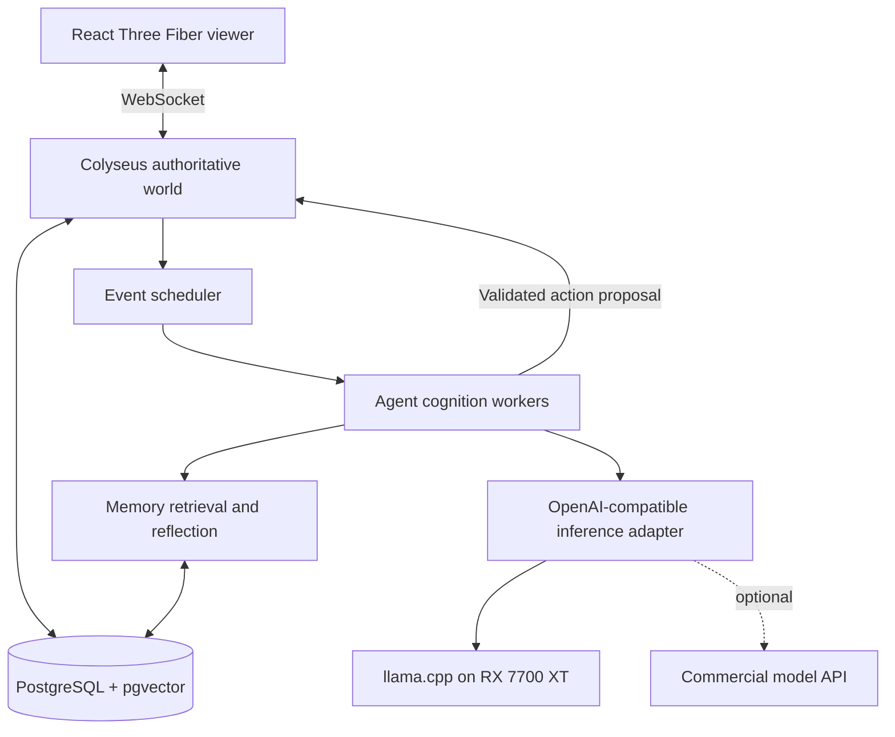

# Autonomous Society Lab

Implementation and deployment blueprint for a persistent, accelerated, multi-agent virtual town. **Planning repository only**; no application runtime has been implemented yet.

## Design targets

- Eight independently motivated agents, expandable to 20.
- Local-first inference on AMD Radeon RX 7700 XT (12 GB VRAM) and 64 GB system RAM.
- Offline-compatible simulation; optionally route complex tasks to commercial APIs.
- Three operating modes: real-time, capped acceleration, and maximum-speed discrete-event fast-forward.
- Versioned world state, replay, snapshots, and experiment branches.
- Private personal deployment, without employer infrastructure or credentials.

## Documents

1. [Implementation plan](docs/IMPLEMENTATION.md): architecture, state, cognition, scheduler, milestones and tests.
2. [Deployment and operations](docs/DEPLOYMENT.md): local AMD stack, environment, security, backups and recovery.
3. [Cost and performance](docs/COSTS-AND-BENCHMARKS.md): throughput model, benchmark protocol, cloud alternatives and budget limits.

## Initial architecture

## Project status

Architecture and implementation plan drafted. No credentials, model weights, infrastructure, or application code are included.

## Non-goals for v1

- Blockchain, tokens, real-money economies, unrestricted autonomous browsing/coding, and public signup.
- Claiming agent consciousness or psychological realism.
- Training or fine-tuning a foundation model.

## Principles

1. The **world server** is authoritative; language models submit proposals, never database mutations.
2. Event-time ordering is deterministic and auditable; inference outputs are recorded for exact replay.
3. Agents perceive only allowed local observations and their own memories.
4. All external AI providers are personal accounts, expressly configured and budget-capped.
5. A headless accelerated simulation must run without the browser or 3D renderer.
